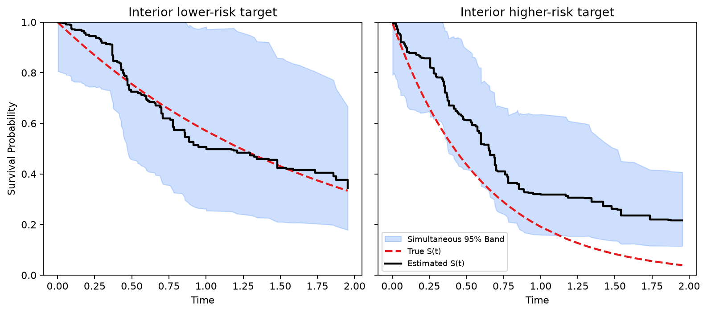

# Survival Confidence Band

This page demonstrates how to construct simultaneous confidence bands for
conditional survival curves at chosen predictor values. The example uses
the smoothed covariance approach in `get_surv_band()` and simulated data
whose true curves are known.

Two details matter for interpretation:

- Check that target predictor values are represented in the training data, especially for the important variables, to limit extrapolation.
- Inspect how many observations remain at risk over time. The far tail has less support when few observations remain under follow-up without an event.

## Data

We simulate right-censored survival data from a proportional hazards
model. The first and third predictors carry signal; the rest are noise.

```python
import numpy as np
from rlt import RLT_surv

rng = np.random.default_rng(2)

n = 200
p = 10
X = rng.normal(size=(n, p))

def xlink(x):
    return np.exp(x[:, 0] + x[:, 2] / 2)

FT = rng.exponential(1.0 / xlink(X))
CT = np.minimum(6, rng.exponential(1.0 / 0.25, size=n))

time = np.minimum(FT, CT)
event = (FT <= CT).astype(bool)

y = np.empty(n, dtype=[("event", "?"), ("time", "<f8")])
y["event"] = event
y["time"] = time
```

## Target Points

We choose two target points at interior quantiles of the important
variables `X1` and `X3`. The remaining variables are fixed at their
training medians.

```python
target_base = np.median(X, axis=0)
testX = np.tile(target_base, (2, 1))

testX[:, 0] = np.quantile(X[:, 0], [0.35, 0.65])
testX[:, 2] = np.quantile(X[:, 2], [0.35, 0.65])

np.round(testX[:, [0, 2]], 3)
```

```
array([[-0.384, -0.385],
       [ 0.315,  0.377]])
```

## Fit and Predict with Variance

We use `var_mode="matched"` to estimate covariance of the predicted
cumulative hazard over time, which is the scale used by the band
calculation. The 1,000 trees form 500 matched pairs using half-samples
without replacement. Matched mode enforces these sampling settings and
reduces an odd requested tree count to the preceding even count; at least
two trees are required. The settings are explicit below.

```python
fit = RLT_surv(
    n_estimators=1000, mtry=min(p, 10), min_samples_leaf=5,
    nsplit=3,
    resample_prob=0.5, resample_replace=False,
    importance="none", verbose=0,
    n_jobs=1,
    var_mode="matched",
    split_rule="logrank",
    random_state=2,
)
fit.fit(X, y)

prediction = fit.predict_details(testX, var_est=True)
S, cov = prediction["Survival"], prediction["Cov"]
S_reference = np.exp(-prediction["CHF"])
```

## Choose a Display Range

The fitted model can return predictions over the observed event-time grid,
but the far right tail has little data support. For this example, we only
display the region `t <= 2`. This cutoff is an illustration, not a
criterion establishing sufficient support. The band is constructed over
the full returned grid, even when the plot shows only part of it.

```python
risk_set = np.array([np.sum(time >= t) for t in prediction["timepoints"]])
plot_time_max = 2
plot_id = prediction["timepoints"] <= plot_time_max

if not plot_id.any():
    plot_id = np.zeros_like(plot_id, dtype=bool)
    plot_id[0] = True

print(f"Plot time range: t <= {plot_time_max}")
print(f"Minimum at-risk in plotted range: {int(risk_set[plot_id].min())}")
print(f"Number of plotted timepoints: {int(plot_id.sum())}")
```

```
Plot time range: t <= 2
Minimum at-risk in plotted range: 33
Number of plotted timepoints: 136
```

## Simultaneous Confidence Band

With `alpha=0.05`, `get_surv_band()` constructs a nominal 95% simultaneous
band separately for each target's conditional survival curve over the
returned grid. It does not provide joint coverage across targets,
continuous-time coverage between grid points, or a prediction interval
for a target's event time.

The reference curve is `S_reference = np.exp(-prediction["CHF"])`.
It equals `S` for this ordinary forest.
For a linear combination forest, returned survival is instead the mean
of tree product-limit curves, whose variation is not directly estimated
by this CHF-based band.

The smoothed approach uses a low-rank covariance approximation and a
residual correction to form marginal standardizing scales. Here
`k_rank=10` allows up to ten components in that approximation. Gaussian
simulations retain the original supplied CHF covariance; `nsim` controls
the number used to estimate the simultaneous critical value. See
[`get_surv_band`](../reference/get_surv_band.md) for smoothing and
numerical implementation details.

```python
from rlt import get_surv_band

SurvBand = get_surv_band(prediction, alpha=0.05, approach="smoothed",
                         k_rank=10, nsim=5000, seed=0)
```

The saved result already contains CHF, its covariance, and the selected
time vector. Reusing it for another rank or confidence level avoids
recomputing forest predictions. The model convenience call
`get_surv_band(fit, testX, ...)` remains available. A tracking-only fit can
use `var_mode="IJ"` or `"jack"` in that call, or in `predict_details`,
when the fitted resampling counts support the requested method.
The plot below retains the raw reference curve and band arrays; only the
displayed probability axis is restricted to `[0, 1]`.

```python
import matplotlib.pyplot as plt

fig, axes = plt.subplots(1, 2, figsize=(10, 4.5), sharey=True)
titles = ["Interior lower-risk target", "Interior higher-risk target"]

for i, ax in enumerate(axes):
    tp = prediction["timepoints"][plot_id]
    S_i = S_reference[i, plot_id]
    truth = np.exp(-xlink(testX)[i] * tp)

    b_lower = SurvBand["lower"][i, plot_id]
    b_upper = SurvBand["upper"][i, plot_id]

    ax.fill_between(tp, b_lower, b_upper, color="#3b82f6", alpha=0.25,
                    label="Simultaneous 95% Band")
    ax.plot(tp, truth, color="#E41A1C", lw=2, ls="--", label="True S(t)")
    ax.step(tp, S_i, where="post", color="black", lw=2, label="Estimated S(t)")

    ax.set_title(titles[i])
    ax.set_xlabel("Time")
    ax.set_ylim(0, 1)

axes[0].set_ylabel("Survival Probability")
axes[1].legend(loc="lower left", fontsize=8)
plt.tight_layout()
plt.show()
```

[](../assets/figures/confidence-interval_00.png)

Select a figure to view it at full size.

The higher-risk target has larger values of both signal variables, so
its true survival curve falls faster. In this realization, that true
curve falls outside the band at some displayed times. A nominal 95%
simultaneous band need not contain the true curve in every dataset, and
one realization cannot establish coverage. Each band was constructed on
the full returned grid, although only the portion through time 2 is
displayed.

## Optional Rank Selection

The smoothed approach can also choose the rank by cumulative eigenvalue
proportion instead of a fixed `k_rank`:

```python
SurvBand_prop = get_surv_band(
    prediction, alpha=0.05,
    approach="smoothed",
    k_mode="proportion",
    k_prop=0.95,
)
```

Increasing `nsim` improves Monte Carlo precision for the simulated
critical value at the cost of runtime. Python and R use different random
streams, so the same integer seed does not imply identical simulated band
limits. Smoother diagnostics report its GCV parameters and convergence;
parameters can be unstable when the GCV objective is flat even if the
fitted surface is stable. Numerical agreement between implementations
does not establish the method's statistical coverage.
