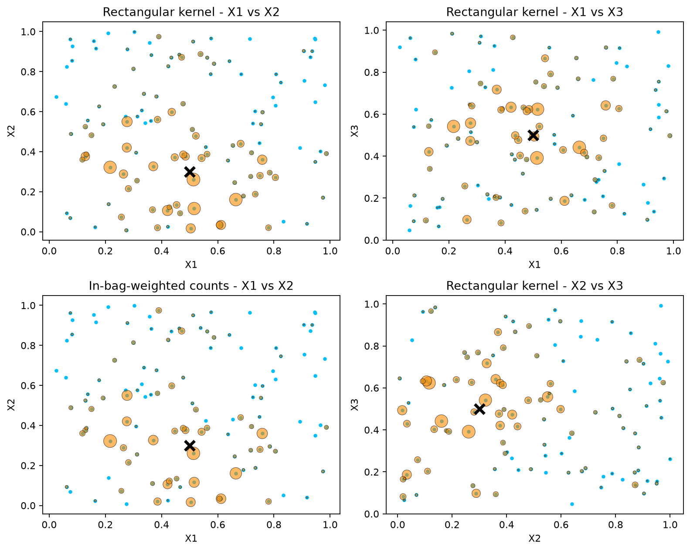
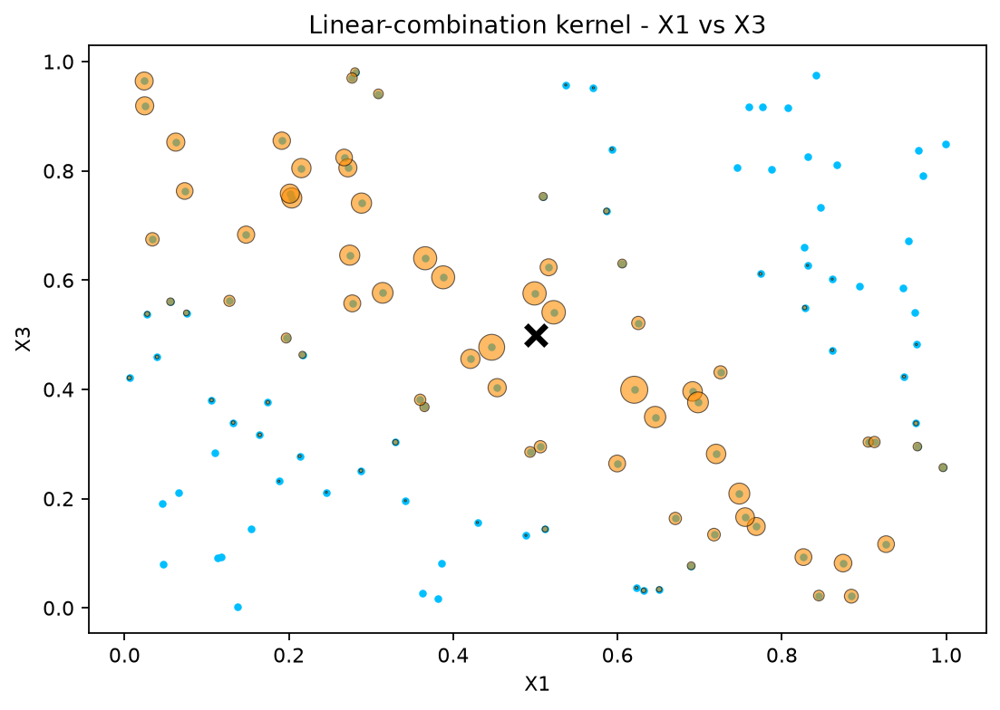

# Random Forest Kernel

`forest_kernel()` measures similarity by counting how often observations
share a terminal node in the fitted forest. The ordinary self-kernel and
cross-kernel return integer counts across all trees. Dividing by
`fit.params_.ntrees` gives leaf-sharing frequencies in `[0, 1]`, not weights
that sum to one across a row.

With `vs_train=True`, each shared-leaf contribution is multiplied by the
training observation's in-bag multiplicity for that tree. Bootstrap repeats
can therefore produce counts larger than the number of trees. This mode
requires retained sampling counts, enabled by `resample_track=True` or an
active `var_mode` at fitting. Supply the original training `X` as `X2`, in
its original row order. The API checks the row count, but cannot detect
shuffled or replaced rows. The OOB self-kernel in Example 3 uses a different,
pair-specific normalization.

## Example 1 - Axis-aligned

We build a regression forest using "best" splits and compare ordinary
leaf-sharing counts with in-bag-weighted counts.

```python
import numpy as np
from rlt import RLT_reg

# ---- Generate a small dataset (about 100 obs) ----
rng = np.random.default_rng(1)
n = 120
p = 5
X = rng.uniform(size=(n, p))
y = X[:, 0] + X[:, 1] + rng.normal(size=n)

# Train the forest (axis-aligned "best" splits)
fit_rect = RLT_reg(
    n_estimators=300, mtry=p, min_samples_leaf=5,
    nsplit=0,  # "best" splits: consider all cut points
    resample_prob=0.8, resample_replace=True,
    importance="permute",
    resample_track=True,
    n_jobs=1,
    random_state=1,
)
fit_rect.fit(X, y)

# Choose a target point
newX = np.full((1, p), 0.5)
newX[0, 1] = 0.3

# Leaf-sharing counts between newX and all X
KW_rect = fit_rect.forest_kernel(newX, X)

# Map counts to marker areas for display only.
size_scale = 180 * KW_rect[0] / KW_rect[0].max()
```

```python
import matplotlib.pyplot as plt

fig, axes = plt.subplots(2, 2, figsize=(10, 8))

# X0 vs X1 (both are signal features)
axes[0, 0].scatter(X[:, 0], X[:, 1], s=8, color="deepskyblue")
axes[0, 0].scatter(X[:, 0], X[:, 1], s=size_scale, color="darkorange",
                   alpha=0.6, linewidths=0.5, edgecolors="black")
axes[0, 0].scatter(newX[0, 0], newX[0, 1], marker="x", s=100,
                   color="black", linewidths=3)
axes[0, 0].set_title("Rectangular kernel - X1 vs X2")

# X0 vs X2 (X3 is noise)
axes[0, 1].scatter(X[:, 0], X[:, 2], s=8, color="deepskyblue")
axes[0, 1].scatter(X[:, 0], X[:, 2], s=size_scale, color="darkorange",
                   alpha=0.6, linewidths=0.5, edgecolors="black")
axes[0, 1].scatter(newX[0, 0], newX[0, 2], marker="x", s=100,
                   color="black", linewidths=3)
axes[0, 1].set_title("Rectangular kernel - X1 vs X3")

# Use the original training rows, in their original order.
KW_rect_train = fit_rect.forest_kernel(newX, X, vs_train=True)
size_scale_train = 180 * KW_rect_train[0] / KW_rect_train[0].max()

axes[1, 0].scatter(X[:, 0], X[:, 1], s=8, color="deepskyblue")
axes[1, 0].scatter(X[:, 0], X[:, 1], s=size_scale_train, color="darkorange",
                   alpha=0.6, linewidths=0.5, edgecolors="black")
axes[1, 0].scatter(newX[0, 0], newX[0, 1], marker="x", s=100,
                   color="black", linewidths=3)
axes[1, 0].set_title("In-bag-weighted counts - X1 vs X2")

# Another projection
axes[1, 1].scatter(X[:, 1], X[:, 2], s=8, color="deepskyblue")
axes[1, 1].scatter(X[:, 1], X[:, 2], s=size_scale, color="darkorange",
                   alpha=0.6, linewidths=0.5, edgecolors="black")
axes[1, 1].scatter(newX[0, 1], newX[0, 2], marker="x", s=100,
                   color="black", linewidths=3)
axes[1, 1].set_title("Rectangular kernel - X2 vs X3")

for ax, (xlabel, ylabel) in zip(
    axes.flat, [("X1", "X2"), ("X1", "X3"), ("X1", "X2"), ("X2", "X3")]
):
    ax.set_xlabel(xlabel)
    ax.set_ylabel(ylabel)

plt.tight_layout()
plt.show()
```

[](../assets/figures/feature-kernel_00.png)

Select a figure to view it at full size.

Orange marker area is proportional to the count, scaled separately for each
kernel; the black cross marks the target. This display scaling does not turn
counts into probability weights, and marker areas cannot be compared
between the ordinary and in-bag-weighted plots. The projections show how
similarity varies along the signal variables (X1, X2) and the noise variable
(X3).

## Example 2 - Linear-combination

We use SIR loadings to split on combinations of up to two predictors and
plot the resulting leaf-sharing counts. See
[Linear Combinations](linear-combinations.md) for direction estimation and
the [embedded-model reference](../reference/rlt_reg.md#embedded-model-controls)
for predictor screening.

```python
rng = np.random.default_rng(1)
n = 120
p = 3
X = rng.uniform(size=(n, p))
y = X[:, 0] + X[:, 2] + 0.3 * rng.normal(size=n)

fit_lc = RLT_reg(
    n_estimators=300, mtry=p, min_samples_leaf=5,
    nsplit=3,
    resample_prob=0.9, resample_replace=False,
    linear_comb=2,
    linear_comb_method="sir",
    importance="permute",
    n_jobs=1,
    random_state=1,
)
fit_lc.fit(X, y)

newX = np.full((1, p), 0.5)
newX[0, 1] = 0.3
KW_lc = fit_lc.forest_kernel(newX, X)
size_scale_lc = 180 * KW_lc[0] / KW_lc[0].max()
```

```python
fig, ax = plt.subplots(figsize=(7, 5))
ax.scatter(X[:, 0], X[:, 2], s=8, color="deepskyblue")
ax.scatter(X[:, 0], X[:, 2], s=size_scale_lc, color="darkorange",
           alpha=0.6, linewidths=0.5, edgecolors="black")
ax.scatter(newX[0, 0], newX[0, 2], marker="x", s=100, color="black",
           linewidths=3)
ax.set_title("Linear-combination kernel - X1 vs X3")
ax.set_xlabel("X1")
ax.set_ylabel("X3")
plt.tight_layout()
plt.show()
```

[](../assets/figures/feature-kernel_01.png)

The larger orange markers lie along a descending band in the two signal
variables. Points in this band have similar values of `X1 + X3`, illustrating
how combination splits can make leaf sharing follow a signal direction.

## Example 3 - OOB self-kernel

The OOB self-kernel compares training observations using only trees where
**both** observations are out-of-bag. Each contributing tree was fitted
without either observation in the pair. It requires retained sampling
counts, enabled by `resample_track=True` or an active `var_mode` at fitting,
and the original training data as `X1`, in the original row order. As with
`vs_train=True`, the API checks the number of rows but does not verify their
identity or order.

```python
import numpy as np
from rlt import RLT_reg

rng = np.random.default_rng(1)
n, p = 120, 5
X = rng.normal(size=(n, p))
y = X[:, 0] + X[:, 1] + rng.normal(size=n)

fit = RLT_reg(
    n_estimators=300, nsplit=2,
    resample_track=True,  # retain sampling counts for the OOB kernel
    n_jobs=1, random_state=1,
)
fit.fit(X, y)

out = fit.forest_kernel(X, oob=True)
K, N, C = out["Kernel"], out["N"], out["C"]
# K = C / N where N > 0, and 0 otherwise
```

`N[i, j]` counts trees where observations `i` and `j` are both
out-of-bag; `C[i, j]` counts those trees where they also land in the same
terminal node; `Kernel = C / N` normalizes them into `[0, 1]`. Pairs that
are never OOB together (`N = 0`) get `Kernel = 0`.

```python
print(K.shape)    # (120, 120)
print(N[0, 1], C[0, 1])   # 48 1
print(np.trace(K))        # 120.0; diagonal is 1 wherever N > 0
```

Use `N` to distinguish an unsupported pair (`N = 0`) from an observed
zero leaf-sharing count. These matrices describe the fitted forest;
using them in a degrees-of-freedom estimator requires that estimator's
own assumptions.
