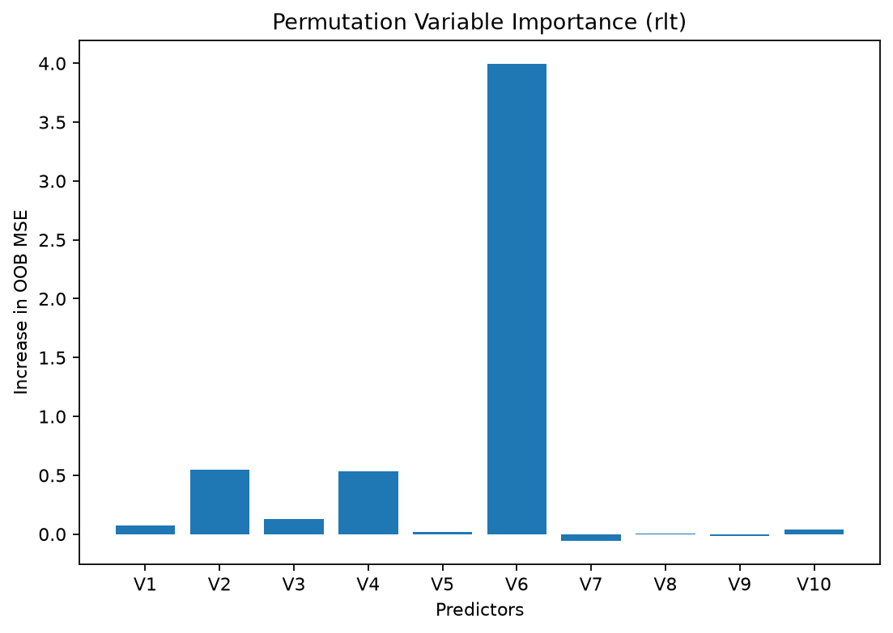
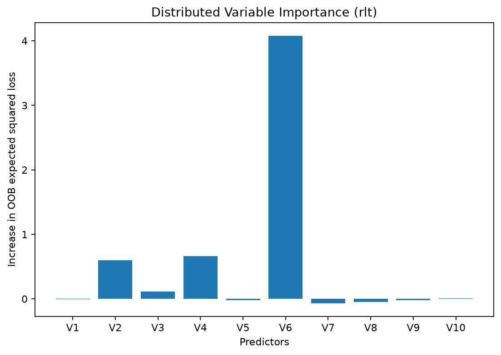

# Variable Importance (Permutation and Distributed)

Variable importance (VI) measures how much a fitted forest relies on each
predictor for prediction. This page illustrates permutation and distributed
importance using out-of-bag (OOB) observations, which were excluded from fitting
the tree in which they are evaluated.

## Data

We generate numeric and categorical predictors with a continuous outcome.
The simulated response depends on predictors at indices 1 through 5. Each
forest declares the last five columns in `categorical_features`. The figures
label the ten predictors `V1` through `V10`, corresponding to indices 0 through 9.

```python
import numpy as np

# (Optional) For reproducibility in this tutorial only.
rng = np.random.default_rng(1)

# ---- Generate a small synthetic dataset ----
trainn = 80
testn = 20
n = trainn + testn
p = 10

# Continuous + categorical predictors (last half as categorical)
X1 = rng.normal(size=(n, p // 2))
X2 = (rng.uniform(size=(n, p // 2)) * 3).astype(int)  # integers 0, 1, 2
X = np.hstack([X1, X2])

# Continuous outcome with a simple signal + noise
y = (
    1
    + X[:, 1:6].sum(axis=1)
    + 2 * np.isin(X[:, p // 2], [1, 2])
    + rng.normal(size=n)
)

# Train / test split
trainX, trainY = X[:trainn], y[:trainn]
testX, testY = X[trainn:], y[trainn:]
```

## Option A - Permutation Importance

Set `importance="permute"` to measure the increase in OOB mean squared error
after permuting a predictor. For each tree, the ordinary loss is the mean
squared error on its OOB observations. The perturbed loss uses the same
observations after shuffling the assessed predictor among them. The forest's
importance is the average of these per-tree loss differences.

```python
from rlt import RLT_reg

# Common fitting and resampling settings for both illustrations
ntrees = 200
nmin = 5
mtry = p // 2
samplereplace = True
sampleprob = 0.80
nsplit = 0

fit_perm = RLT_reg(
    n_estimators=ntrees,
    mtry=mtry,
    min_samples_leaf=nmin,
    resample_prob=sampleprob,
    resample_replace=samplereplace,
    nsplit=nsplit,
    importance="permute",  # permutation-based VI
    categorical_features=range(p // 2, p),
    n_jobs=1,
    random_state=1,
)
fit_perm.fit(trainX, trainY)

# VI vector lives in feature_importances_
np.round(fit_perm.feature_importances_, 3)
```

```
array([ 7.500e-02,  5.440e-01,  1.290e-01,  5.340e-01,  2.100e-02,
        3.994e+00, -5.400e-02,  3.000e-03, -1.600e-02,  4.100e-02])
```

Here `nsplit=0` searches all available cutpoints. Each tree draws 80% of the
sample size with replacement, so an observation can be drawn more than once.
OOB importance does not require retaining the resampling records with
`resample_track=True`.

```python
import matplotlib.pyplot as plt

# Simple visualization
predictor_names = [f"V{j + 1}" for j in range(p)]
fig, ax = plt.subplots(figsize=(7, 5))
ax.bar(predictor_names, fit_perm.feature_importances_)
ax.set_title("Permutation Variable Importance (rlt)")
ax.set_ylabel("Increase in OOB MSE")
ax.set_xlabel("Predictors")
fig.tight_layout()
plt.show()
```

[](../assets/figures/variable-importance_00.png)

Select a figure to view it at full size.

`V6` has the largest permutation importance in this fit. A value near zero
indicates little measured loss from permutation; a negative value means that
permutation reduced the measured OOB loss. Such values can arise from sampling
and forest randomness and do not prove that a predictor has no effect.
Importance describes predictive reliance rather than a causal effect.

## Option B - Distributed Assignment Importance

Set `importance="distribute"` to route an OOB observation to both children
at splits involving the assessed predictor, with probabilities proportional
to the child node weights. Other splits follow the observation's predictor
values as usual.

For a fixed tree and OOB observation with response \(y_i\), let
\(q_{i\ell}\) be the resulting probability of reaching terminal node
\(\ell\), whose prediction is \(\mu_\ell\). The distributed loss for
that observation is

\[
\sum_\ell q_{i\ell}(y_i-\mu_\ell)^2.
\]

The tree averages this expected squared loss over its OOB observations and
subtracts its ordinary OOB mean squared error. The forest then averages the
per-tree differences. The expectation is over squared losses along the
routes; the method does not first average terminal-node predictions and then
compute a squared loss.

The next fit uses the same data and fitting and resampling settings, changing
only the importance method. Both methods need OOB observations; sampling almost
all observations without replacement can leave too few for importance calculation.

```python
fit_dist = RLT_reg(
    n_estimators=ntrees,
    mtry=mtry,
    min_samples_leaf=nmin,
    nsplit=nsplit,
    resample_prob=sampleprob,
    resample_replace=samplereplace,
    importance="distribute",  # distributed assignment VI
    categorical_features=range(p // 2, p),
    n_jobs=1,
    random_state=1,
)
fit_dist.fit(trainX, trainY)

# VI vector lives in feature_importances_
np.round(fit_dist.feature_importances_, 3)
```

```
array([-0.005,  0.6  ,  0.116,  0.665, -0.018,  4.077, -0.065, -0.045,
       -0.023,  0.006])
```

```python
fig, ax = plt.subplots(figsize=(7, 5))
ax.bar(predictor_names, fit_dist.feature_importances_)
ax.set_title("Distributed Variable Importance (rlt)")
ax.set_ylabel("Increase in OOB expected squared loss")
ax.set_xlabel("Predictors")
fig.tight_layout()
plt.show()
```

[](../assets/figures/variable-importance_01.png)

`V6` also has the largest distributed importance in this fit. Both methods
describe predictive reliance, but they perturb predictor use differently.
Their rankings illustrate these two fits; common settings do not make the
measures equivalent or establish a performance comparison. Near-zero
distributed importance indicates little measured increase in loss; a negative
value means the distributed expected loss was below the ordinary OOB loss.
Neither proves that a predictor has no effect.

## Variance of variable importance (matched forests)

Fitting with `var_mode="matched"` and either importance option also estimates
the variance of each VI estimate. These estimates help assess uncertainty in
the fitted importance values.

The matched-sample variance framework is described by
[Xu, Zhu, and Shao (2024)](https://doi.org/10.1214/24-EJS2247).

```python
fit_vi = RLT_reg(
    n_estimators=ntrees,
    mtry=mtry,
    min_samples_leaf=nmin,
    importance="distribute",
    var_mode="matched",   # per-variable variance of VI
    categorical_features=range(p // 2, p),
    n_jobs=1,
    random_state=1,
)
fit_vi.fit(trainX, trainY)

# (p,) variance of each VI estimate
np.round(fit_vi.var_vi_, 4)
```

```
array([ 5.00e-04,  1.07e-02,  1.39e-02,  3.79e-02, -2.72e-02,  5.44e-01,
       -5.50e-03,  3.80e-03, -1.00e-04,  1.33e-02])
```

`importance_table()` prints `Variable` and `VI`. When matched variance is
available, the column named `SD` is the estimated standard error of the VI
estimate, computed as `SD = sqrt(VarVI)`. The table also reports the standardized
statistic `Z = VI / SD` and a significance code (`***` for \(|Z|\ge 2.58\),
`**` for \(|Z|\ge 1.96\), and `*` for \(|Z|\ge 1.64\)). These codes summarize
the standardized values; they do not certify variable selection or causal
importance. The layout mirrors R's `print.importance.RLT`:

```python
fit_vi.importance_table()
```

```
Variable             VI           SD          Z  Sig
----------------------------------------------------------
V1              -0.0209     0.021899      -0.95
V2               0.5996     0.103274       5.81  ***
V3               0.0609     0.117999       0.52
V4               0.5832     0.194568       3.00  ***
V5              -0.0230           NA         NA
V6               3.8730     0.737591       5.25  ***
V7              -0.0231           NA         NA
V8              -0.0973     0.061325      -1.59
V9              -0.0141           NA         NA
V10             -0.0504     0.115454      -0.44

Note: 3 variable(s) with negative variance estimate (SD, Z shown as NA)
```

Two things to note in this output:

- **Negative variance estimates.** The matched U-statistic variance can
  come out negative in a finite forest. Exactly like R, such variables
  get `NA` for `SD` and `Z` and an empty significance code, and the
  table appends a trailing `Note` counting them. A negative variance
  estimate does not by itself show that a variable is noise.
- **Without matched variance**, the table simply has no `SD` / `Z` /
  `Sig` columns. `importance_table()` works for any
  `importance != "none"` fit and prints just `Variable` and `VI`.

The same table is available through the module-level function
`rlt.importance(model)`, mirroring R's `importance(fit)` idiom (the
estimator attribute `.importance` holds the constructor parameter
string, so the method could not take that name):

```python
import rlt

rlt.importance(fit_vi)   # same table as fit_vi.importance_table()
```

!!! note
    `var_mode="matched"` implies the matched-forest preset: subsampling
    without replacement at 50% and an even tree count. When importance is
    omitted, distributed importance is enabled automatically. Both
    `importance="permute"` and `importance="distribute"` can be requested
    explicitly; the selected importance measure is retained.
