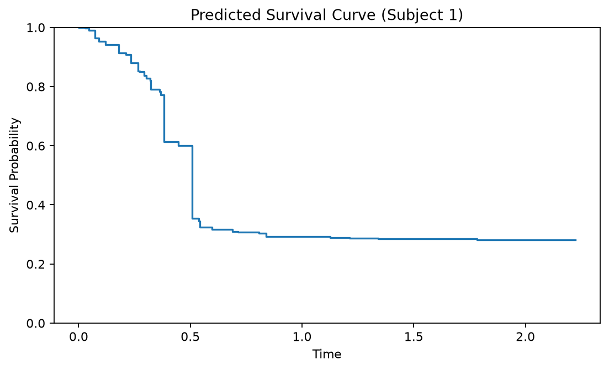
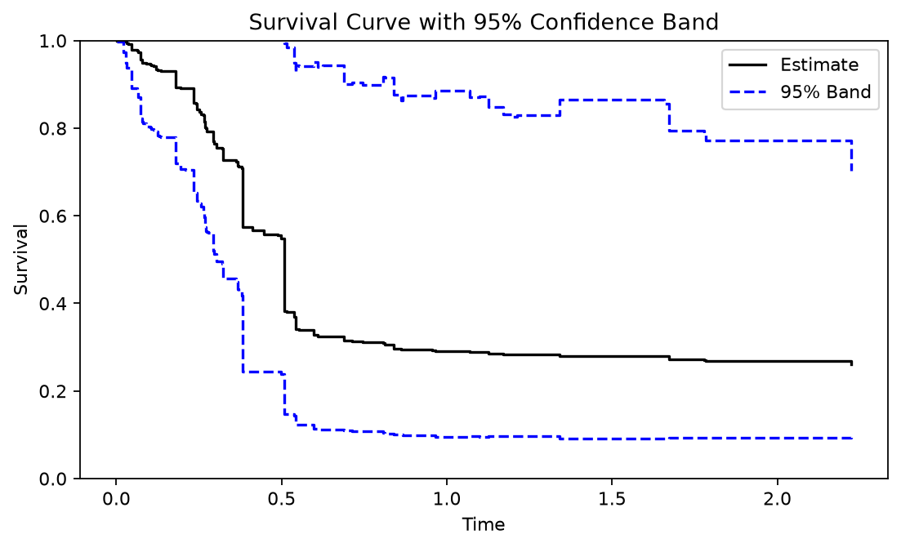

# RLT Survival Analysis Tutorial

This vignette introduces survival analysis with **rlt** (Reinforcement
Learning Trees). RLT survival forests estimate conditional survival
probabilities and cumulative hazards, and return hazard increments on an
observed failure-time grid. Key features include:

- **Three split rules**: logrank (default), suplogrank, and coxgrad.
- **Linear combination (LC) splits**: combine multiple variables into a single split direction.
- **Variance estimation**: matched-sample U-statistic, infinitesimal jackknife (IJ), and jackknife.
- **Confidence bands**: `get_surv_band()` provides naive or smoothed simultaneous bands for survival curves.
- **Tree inspection**: `get_one_tree()` inspects individual tree structures.

The examples below use small simulated datasets so that all code runs quickly.

## Simulated data

We simulate data from a proportional hazards model with exponential event
times and independent censoring. The first two predictors carry signal;
the rest are noise.

```python
import numpy as np
from rlt import RLT_surv

rng = np.random.default_rng(42)
n = 200
p = 5
X = rng.normal(size=(n, p))

beta = np.array([0.8, 0.5, 0, 0, 0])
hazard = np.exp(X @ beta)
surv_time = rng.exponential(1.0 / hazard)
censor_time = rng.uniform(0, 3, size=n)

time = np.minimum(surv_time, censor_time)
event = (surv_time <= censor_time).astype(int)

np.bincount(event)  # 0 = censored, 1 = observed event
```

Responses follow the scikit-survival convention: a structured array with
`event` and `time` fields (`1` = event observed, `0` = censored):

```python
y = np.empty(n, dtype=[("event", "?"), ("time", "<f8")])
y["event"] = event.astype(bool)
y["time"] = time
```

## Basic usage

Fit a survival forest with `RLT_surv`. By default `split_rule="logrank"`.

```python
fit = RLT_surv(
    n_estimators=100,
    min_samples_leaf=5,
    n_jobs=1,
    random_state=42,
)
fit.fit(X, y)
```

Predict at selected predictor values to obtain survival curves and
cumulative hazards. Here five training rows illustrate the returned
arrays. These predictions use all trees and do not evaluate out-of-sample
performance:

```python
S = fit.predict_survival_function(X[:5])        # S(t), shape (5, T)
chf = fit.predict_cumulative_hazard_function(X[:5])  # H(t), shape (5, T)

# T is the number of unique failure times
fit.timepoints_.shape
```

Each component is an `n x T` matrix, where `T` is the number of unique
failure times (`fit.timepoints_`). On this full grid, the hazard increment
`h(t)` can be recovered from the cumulative hazard:

```python
hazard = np.diff(chf, prepend=0.0, axis=1)  # h(t) at each failure time
```

Plot the predicted survival curve for the first subject:

```python
import matplotlib.pyplot as plt

plt.figure(figsize=(7, 4.3))
plt.step(fit.timepoints_, S[0], where="post")
plt.xlabel("Time")
plt.ylabel("Survival Probability")
plt.title("Predicted Survival Curve (Subject 1)")
plt.ylim(0, 1)
plt.tight_layout()
plt.show()
```

[](../assets/figures/survival-tutorial_00.png)

Select a figure to view it at full size.

Each downward step lowers the estimated probability of survival beyond
that time; flat segments indicate no change between failure times. This
is a conditional curve at one subject's predictor values. For this
ordinary forest, `S` equals `np.exp(-chf)`.

### Response validation

`fit()` checks survival times and event indicators before growing the
forest. Missing or invalid values raise a `ValueError`:

```python
# NaN/Inf in time
y_bad_time = y.copy()
y_bad_time["time"][0] = np.nan

# A floating event array can contain NaN; a structured bool field cannot.
event_nan = np.concatenate([[np.nan], np.ones(n - 1)])

# Event values must be 0 or 1.
event_bad = np.full(n, 2.0)

for y_try in (y_bad_time, (y["time"], event_nan), (y["time"], event_bad)):
    try:
        RLT_surv(n_estimators=20, n_jobs=1, random_state=0).fit(X, y_try)
    except ValueError as err:
        print("ValueError:", err)
```

```
ValueError: NA/Inf not permitted in y
ValueError: NA not permitted in censor
ValueError: censor must be 0 or 1
```

Check invalid outcomes against the source records and the study's event
and censoring definitions. Handling missing outcomes requires an analysis
decision; arbitrary imputation or recoding changes the survival data.

## Split rules

`rlt` provides three splitting criteria for survival trees:

| Rule | How it scores a split |
|------|----------------------|
| `logrank` | Standard log-rank test statistic (default) |
| `suplogrank` | Maximum of the standardized log-rank process over time |
| `coxgrad` | Gradient of Cox partial likelihood |

Fit the three rules on the same data and compare out-of-bag error
estimates. The error is `1 - C`, using a risk score that sums the OOB
cumulative hazards over the full failure-time grid. Lower values are
better; this sum is neither the final cumulative hazard nor a time
integral. Each observation's OOB predictions use trees fitted without
that observation. Concordance is undefined without comparable event-time
pairs.

```python
fit_lr = RLT_surv(n_estimators=100, split_rule="logrank",
                  n_jobs=1, random_state=42)
fit_slr = RLT_surv(n_estimators=100, split_rule="suplogrank",
                   n_jobs=1, random_state=42)
fit_cg = RLT_surv(n_estimators=100, split_rule="coxgrad",
                  n_jobs=1, random_state=42)

fit_lr.fit(X, y); fit_slr.fit(X, y); fit_cg.fit(X, y)

print(f"logrank:     {fit_lr.oob_error_:.5f}")
print(f"suplogrank:  {fit_slr.oob_error_:.5f}")
print(f"coxgrad:     {fit_cg.oob_error_:.5f}")
```

```
logrank:     0.34945
suplogrank:  0.35366
coxgrad:     0.40004
```

These values describe this simulated dataset and do not establish a
general ranking of the split rules. `logrank` is the default.

## Observation weights

Observation weights are passed via the `sample_weight` argument of `fit`.
All three survival split rules use them; weighted `logrank` and
`suplogrank` include weights in their split-score variance calculation.
Weights must be finite and nonnegative with positive total mass. They do
not change how observations are sampled for each tree. The arbitrary
positive weights below illustrate the syntax and have no scientific
interpretation in this simulation.
Individual zero weights are allowed, but every sampled outer or embedded
tree must have positive total weight; a zero-weight sampled tree raises an error.

```python
w = rng.uniform(size=n)
fit_w = RLT_surv(n_estimators=100, split_rule="coxgrad",
                 n_jobs=1, random_state=1)
fit_w.fit(X, y, sample_weight=w)
```

## Linear combination splits

When `linear_comb > 1`, a split can combine up to `linear_comb` variables
in one direction. For survival forests, the available methods are:

- `"coxph"` (default): coefficients from a local Cox model fit.
- `"naive"`: direction based on weighted survival score statistics.

```python
fit_lc = RLT_surv(
    n_estimators=100,
    split_rule="logrank",
    linear_comb=3,
    linear_comb_method="coxph",
    n_jobs=1,
    random_state=1,
)
fit_lc.fit(X, y)
```

Predictions from LC forests have the same structure as standard forests.
Their survival estimate is the mean of tree product-limit curves, which
can differ from `exp(-CHF)`:

```python
S_lc = fit_lc.predict_survival_function(X[:5])
S_lc.shape  # (5, T)
```

## Variable importance

Set `importance="permute"` to compute the decrease in OOB concordance
after permuting a variable. Larger positive values indicate greater
contribution to risk ordering. This measure differs from the statistic
used to select a split. Outcomes with no comparable pairs cannot supply
a defined importance contribution.

```python
fit_imp = RLT_surv(n_estimators=100, importance="permute",
                   n_jobs=1, random_state=1)
fit_imp.fit(X, y)

np.round(fit_imp.feature_importances_, 3)
```

```
array([ 0.05 ,  0.036, -0.004, -0.003,  0.004])
```

The two signal variables have the largest importance estimates in this
run. Small negative values can occur when permutation happens to improve
OOB concordance; they do not imply a protective effect.

## Variance estimation and confidence bands

`rlt` supports three variance estimation strategies for survival
predictions:

- **`"matched"`**: matched-sample U-statistic decomposition using paired half-samples without replacement and an even number of trees. See [Xu, Zhu, and Shao (2024)](https://doi.org/10.1214/24-EJS2247) for the variance estimation framework.
- **`"ij"`**: infinitesimal jackknife.
- **`"jack"`**: jackknife-after-bootstrap variance.

Enable variance estimation during fitting via `var_mode`, then save the
prediction with its CHF covariance and time grid. Here 1,000 trees form
500 matched pairs. Matched mode enforces the resampling settings shown
below and reduces an odd tree count to the preceding even count; it
requires at least two trees.

```python
fit_var = RLT_surv(n_estimators=1000, var_mode="matched",
                   resample_prob=0.5, resample_replace=False,
                   n_jobs=1, random_state=42)
fit_var.fit(X, y)

# Training rows illustrate the prediction format, not validation.
pred_var = fit_var.predict_details(X[:3], var_est=True)
Sv, cov = pred_var["Survival"], pred_var["Cov"]

# cov is an (n, T, T) array: covariance of the cumulative hazard over time
print(Sv.shape, cov.shape)  # (3, 131) (3, 131, 131)
```

`predict_var()` also returns `(Sv, cov)` when the full prediction dictionary
is not needed. Variance estimation generally needs more trees than the
small fitting examples above; 1,000 trees is an illustration, not a
coverage guarantee.

## Confidence bands with `get_surv_band()`

The cumulative-hazard covariance and Gaussian simulation framework for
survival bands is developed in
[Formentini, Liang, and Zhu (2022)](https://arxiv.org/abs/2204.12038).
See the [`get_surv_band` reference](../reference/get_surv_band.md#approaches)
for the current smoothing and covariance handling.

With `alpha=0.05`, `get_surv_band()` constructs a nominal 95% simultaneous
band for each target's conditional survival curve over the returned time
grid. This is neither joint coverage across targets nor continuous-time
coverage between grid points, and it is not a prediction interval for an
individual's event time.

The reference curve is `np.exp(-pred_var["CHF"])`. It equals returned
survival for an ordinary forest. LC forests instead return the mean of
tree product-limit curves; this CHF-based band does not directly estimate
variation in that different estimator. Two approaches are available:

- **`"naive"`**: uses the full covariance matrix with a Monte Carlo critical value.
- **`"smoothed"`**: uses a smoothed low-rank covariance approximation with a residual correction to form marginal standardizing scales.

Both approaches simulate from the original supplied CHF covariance.

```python
from rlt import get_surv_band

# Naive band for the first row in the saved prediction
band_naive = get_surv_band(pred_var, i=1, alpha=0.05,
                           approach="naive", nsim=5000)

# Smoothed band
band_smooth = get_surv_band(pred_var, i=1, alpha=0.05,
                            approach="smoothed", nsim=5000, k_rank=10)
```

Reuse the saved dictionary to compare band settings without recomputing
forest predictions. Plot the CHF-based reference curve with the naive
band, retaining the raw limits and restricting only the displayed axis:

```python
t = band_naive["timepoints"]
S1 = np.exp(-pred_var["CHF"][0])

plt.figure(figsize=(7, 4.3))
plt.step(t, S1, where="post", color="black", label="Estimate")
plt.step(t, band_naive["lower"][0], where="post", color="blue",
         linestyle="--", label="95% Band")
plt.step(t, band_naive["upper"][0], where="post", color="blue",
         linestyle="--")
plt.xlabel("Time"); plt.ylabel("Survival")
plt.title("Survival Curve with 95% Confidence Band")
plt.ylim(0, 1)
plt.legend(loc="upper right")
plt.tight_layout()
plt.show()
```

[](../assets/figures/survival-tutorial_01.png)

The band describes uncertainty about the conditional curve at these
predictor values. This training-row illustration does not assess its
coverage or predictive performance.

You can also request all subjects at once with `i=0` (the default).

## Reducing the time grid for bands

For large datasets, the full set of failure times can make covariance
matrices unwieldy. Use `band_grid_size` in `predict_var()` (or pass it to
`get_surv_band()` with a fitted model and query covariates) to evaluate variance
on a reduced quantile-based grid. A saved prediction already fixes its grid:

```python
S3, cov3 = fit_var.predict_var(X[:3], band_grid_size=50)
S3.shape  # (3, 50), at most 50 time points
```

Selected quantiles can coincide, so the requested size is a maximum.
Cumulative hazards still include increments at all earlier failure times.
Bands on a reduced grid describe the selected times and do not establish
coverage between omitted times.

## Inspecting individual trees

Use `get_one_tree()` to inspect the structure of any tree in the fitted
forest. It returns the raw arrays of the tree (0-indexed):

```python
tree = fit.get_one_tree(0)
tree.keys()
```

```
dict_keys(['SplitVar', 'SplitValue', 'LeftNode', 'RightNode', 'NodeWeight', 'NodeHaz'])
```

```python
n_nodes = len(tree["SplitVar"])
n_splits = int((tree["SplitVar"] >= 0).sum())
print(f"{n_nodes} nodes, {n_splits} splits")
```

```
121 nodes, 60 splits
```

A node `i` is internal when `SplitVar[i] >= 0`: the split sends points with
`X[SplitVar[i]] <= SplitValue[i]` to `LeftNode[i]` and the rest to
`RightNode[i]`. Terminal nodes have `SplitVar[i] == -1`.

For LC forests, `tree_summary()` shows each split direction with its
coefficients. Preview the first few nodes:

```python
lc_summary = fit_lc.tree_summary(0)
for node in lc_summary["Node"][:5]:
    print(node, lc_summary["Split"][node], lc_summary["Value"][node])
```

Raw LC `SplitVar` and `SplitLoad` arrays have one row for every node,
including terminal nodes. Apply the same internal-node mask to both:

```python
lc_tree = fit_lc.get_one_tree(0)
lc_variables = np.asarray(lc_tree["SplitVar"])
lc_loadings = np.asarray(lc_tree["SplitLoad"])
internal = lc_variables[:, 0] >= 0
internal_variables = lc_variables[internal]
internal_loadings = lc_loadings[internal]
print(lc_loadings.shape, internal_loadings.shape)
```

```
(97, 3) (48, 3)
```

## Summary

- Fit a survival forest with `RLT_surv().fit(X, y)`.
- Predict with `predict_survival_function()` / `predict_cumulative_hazard_function()` to obtain `S(t)` and `H(t)`.
- Choose `split_rule` among `"logrank"`, `"suplogrank"`, and `"coxgrad"`.
- Use `sample_weight` for weighted fitting with any of the three split rules.
- Allow up to `k` variables per LC split with `linear_comb=k, linear_comb_method="coxph"`.
- Request variable importance with `importance="permute"` and inspect via `feature_importances_`.
- Estimate prediction variance with `var_mode="matched"` / `"ij"` / `"jack"`, then call `predict_var()`.
- Build confidence bands from a saved prediction with `get_surv_band(prediction, approach="naive" or "smoothed")`.
- Inspect readable trees with `tree_summary(i)` or raw arrays with `get_one_tree(i)`.
